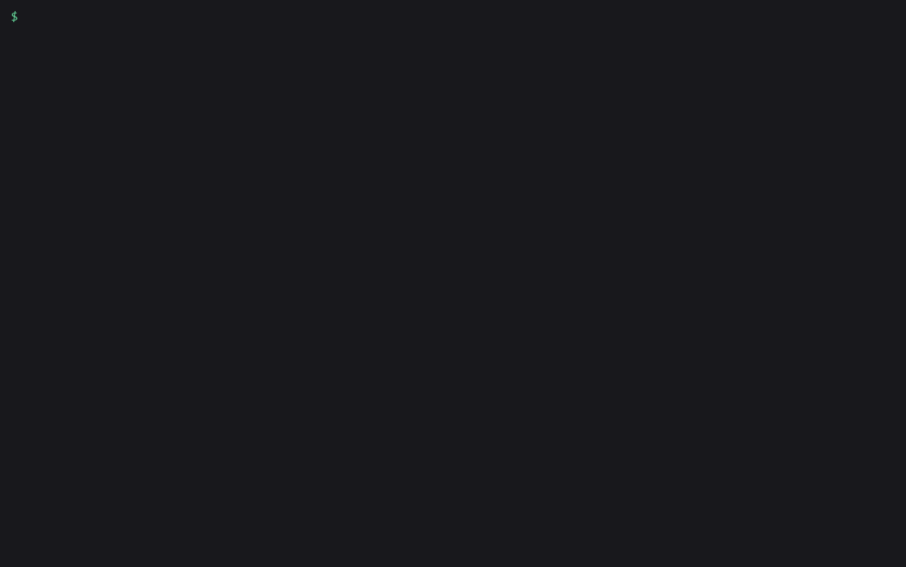

# amagi-codetour

Generate a VS Code CodeTour for any repo. Claude walks from the entry point through the 8 to 15 files a newcomer needs, and every step is checked against the code before the tour is saved.



## Install

```bash
pipx install amagi-codetour
```

Python 3.9 or newer, no required dependencies. To write the tour with Claude you need either the [Claude Code](https://docs.anthropic.com/en/docs/claude-code) CLI (`claude`) logged in, or an Anthropic API key with `pipx install "amagi-codetour[anthropic]"`. Without either, `--engine static` builds the tour from the import graph alone.

Open the result in VS Code with the [CodeTour extension](https://marketplace.visualstudio.com/items?itemName=vsls-contrib.codetour). It picks up `.tours/` on its own.

## Usage

```bash
amagi-codetour plan .                      # entry points and the files a tour would cover (no LLM)
amagi-codetour generate .                  # write .tours/getting-started.tour
amagi-codetour check .                     # verify every step of every tour
amagi-codetour check . --fix               # move drifted steps to where their code is now
```

`plan` shows what the tour will cover before any model is called. This is the real output on this repo:

```
$ amagi-codetour plan .
amagi-codetour: 17 source files (python 17)
Entry points:
  src/amagi_codetour/cli.py  (console script `amagi-codetour` -> `amagi_codetour.cli:main` (pyproject.toml))
  src/amagi_codetour/__main__.py  (`python -m` entry (`__main__.py`))
Tour order (10 files):
   1. src/amagi_codetour/cli.py:260      main  [117]
   2. src/amagi_codetour/check.py:59     norm_path  [31.68]
   3. src/amagi_codetour/plan.py:204     build_plan  [27]
   4. src/amagi_codetour/scan.py:156     scan  [31.68]
   5. src/amagi_codetour/tour.py:90      static_tour  [35]
   6. src/amagi_codetour/llm.py:53       build_prompt  [27]
   7. src/amagi_codetour/anchors.py:22   pattern_for  [30]
   8. src/amagi_codetour/entry.py:204    find_entries  [22]
   9. src/amagi_codetour/graph.py:258    build_graph  [26.68]
  10. src/amagi_codetour/symbols.py:168  file_symbols  [22]
```

The number in brackets is the file's score. It comes from whether the file is an entry point, how far it sits from one, how many other files import it, and its size. The name after each path is the definition that file's step will point at.

`generate` sends the numbered source of those files to Claude and asks for a tour where every step quotes the line it points at. The tool then looks each quote up in the file. If the quote isn't there, the step is dropped and you get a note. If only the line number is off, the step moves to the line that holds the quote. The finished tour goes through `check` before it is written:

```
$ amagi-codetour generate . --force
Asking claude to trace amagi-codetour (12 candidate files)...
Wrote .tours/getting-started.tour: 18 steps across 11 files (claude engine), all anchors verified.
```

Each step stores the line number and a `pattern` copied from that line, which is how `check` tells when the code moved under the tour:

```json
{
  "file": "src/amagi_codetour/cli.py",
  "line": 260,
  "title": "CLI entry point",
  "description": "Execution starts here. pyproject.toml maps the `amagi-codetour` console script to `amagi_codetour.cli:main`. `main` switches stdout and stderr to UTF-8, builds the parser with `build_parser`, and calls `args.func(args)`, which is `cmd_generate`, `cmd_plan` or `cmd_check` depending on the subcommand. It turns `SystemExit` and `KeyboardInterrupt` into plain exit codes.",
  "pattern": "^\\s*def main\\(argv=None\\) -> int:"
}
```

### Keeping tours accurate

Tours go stale quietly. Someone adds a function above the one a step points at, and the step now lands on the wrong line. `check` catches that. This is what it printed on this repo after two small edits to `cli.py` and `plan.py`:

```
$ amagi-codetour check .
.tours/getting-started.tour: 'Getting started with amagi-codetour': 17 steps, 3 broken, 0 warnings -> FAIL
  [FAIL] step 1 src/amagi_codetour/cli.py:255: code moved: anchored text is now at line 260
  [FAIL] step 3 src/amagi_codetour/cli.py:209: anchored line is blank; code moved: anchored text is now at line 213
  [FAIL] step 6 src/amagi_codetour/plan.py:198: code moved: anchored text is now at line 203
Run again with --fix to move drifted steps to where their code is now.
$ amagi-codetour check . --fix
getting-started.tour: fixed 3 step(s)
.tours/getting-started.tour: 'Getting started with amagi-codetour': 17 steps, 0 broken, 0 warnings -> OK
```

`check` exits 1 when any step is broken, so it can run in CI or a pre-commit hook. A step fails when its file is gone, its line is past the end of the file, or the line no longer matches its `pattern`. It warns when a description names an identifier in backticks that does not appear in the file. `--strict` turns warnings into failures. `--fix` only moves steps whose anchored line still exists somewhere in the file. If the code was deleted, regenerate.

### Engines

| `--engine` | What writes the steps |
|---|---|
| `auto` (default) | `anthropic` if `ANTHROPIC_API_KEY` is set and the SDK is installed, else `claude` if it is on PATH, else `static` |
| `claude` | `claude -p`, using the login Claude Code already has |
| `anthropic` | The Anthropic API. Model from `--model`, `AMAGI_CODETOUR_MODEL`, or `claude-opus-5` |
| `static` | No model. Steps come from docstrings, definitions and the import graph |

`--llm-cmd "CMD"` sends the prompt on stdin to any command and reads the JSON reply from its stdout, so you can use another model or a script. `generate --print-prompt` prints the prompt and exits, if you want to paste it into a chat yourself.

Other options: `--min-files` and `--max-files` (default 8 and 15), `--title`, `-o` for the output path, `--stdout`, `--no-readme`, and `--pattern-only` for steps that store a pattern but no line number. `plan --json` and `check --json` print machine-readable results.

The import graph understands Python, JavaScript and TypeScript (including `tsconfig` path aliases), Go and Rust. Entry points come from `pyproject.toml` scripts, `__main__.py`, `package.json` `bin` and `main`, Go `main` packages, Rust `src/main.rs` and `src/bin/`, Java and C# `main` methods, Ruby `bin/`, and common names like `main.py`, `app.py` and `index.ts`.

## Claude Code skill

[`.claude/skills/amagi-codetour/SKILL.md`](.claude/skills/amagi-codetour/SKILL.md) teaches Claude Code when to run the tool: onboarding someone, a request for a walkthrough of a repo, or a repo whose tours may be out of date. Copy the folder into `~/.claude/skills/` or into a project's `.claude/skills/`.

## Limits

- `check` verifies anchors and identifier names. It does not check that every sentence of a description is true. Read the tour once before you share it.
- The `anthropic` engine is covered by unit tests against a stand-in SDK, not by a live API call. The `claude` engine was run for real to write this repo's own tour in [`.tours/`](.tours/).
- Other languages still get a tour, but without an import graph the files are ranked by entry points, names and size only.
- Very large repos are cut to fit the prompt: the top 24 ranked files, up to 320 lines each.

## Star

If this got someone through their first day in a codebase, a star helps other people find it.

## More from AmagiLabs

[amagi-legal-review-skills](https://github.com/amagilabs/amagi-legal-review-skills) is a pack of Claude Code skills for a first-pass review of NDAs, MSAs and leases. [github.com/amagilabs](https://github.com/amagilabs) has the other small open source dev tools from the same lab.

## License

MIT, see [LICENSE](LICENSE). Copyright (c) 2026 Amagisolutionsgroup, Inc. (AmagiLabs).
